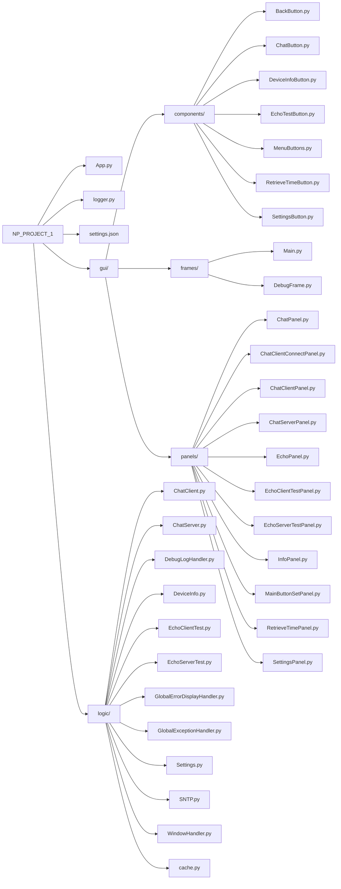

# Network Utils in Python
This project is a GUI application, contains various of network actions.
System network information (hostname, IP addresses, network interfaces), client-server connection testing, chat module, SNTP time information, settings and error handling.

## Device Network Info
This module displays hostname of the current computer, network interfaces and ip addresses related to network interfaces.

Instead of using `getbyhostname()`, it uses `netifaces` library and gets ip addresses of each network interface. This is a faster approach (saves 10 seconds on my computer) and returns more detailed information.

## Client-Server Echo Test Module
In this module one computer picks client and other picks server mode. The server constants like **hostname, port, backlog, payload size, timeout** and **accept count** can be changed from in-app settings panel or `settings.json` file located in root folder of this application.

Server can be opened with one click and if there is an error occours, error window will pop up.

The server accepts messages count of **echoClientPayloadCount** value in settings. If value is set to `0`, server will be `closed` immidiately. If value is `-1`, server will accept `unlimited` number of payload.

Client must write **hostname, port** and **message** values by hand for every test.

## Chat Module
Again in this module one computer becomes server and others client. Multiple clients can connect to same chat server.

Server values can be set from settings panel. Client values are taken from user for every connection.

Server starts, stores each client connection and travels on them for each new message. The received messages are being displayed on the window. If server sends a message, it will be sent to all stored connected clients. Each message successfully being sent and received will be written into file with name `"<current_date>.txt"` under folder `chats` on root folder. The write operation is done when the server disconnects (closing the writer).

Client connects with a **name, hostname** and **port** values. Name is username of the client, rest belongs to the server. Again same logic holds here. When a client sends message, it is sent to all clients and server. File output logic is same.

## SNTP
This is the simpliest module. It just retrieves the time information from given SNTP server URL in settings and displays it along side with local time information.

## Settings
Different values for different modules can be changed here.

Changing `logging` will only disable file output, command line logging stays.

`Debugging` setting will show a debug window, which displays logs in real time. Work principle is simple, if debugging and debug window, show in debug window. It uses a custom `StreamHandler` for this work.

## Error Handling
There is a `logs` folder which contains `error.log` and `app.log`. You can get what they log by looking at the names.

Writing logs into a file can be disabled from settings, but console logging is permanent.

When an error occours during runtime, the error will be displayed to the user in a pop-up window. If it happens during loading a panel, the WindowHandler will check if the panel exists. Because each panel with exception possibility has `destroy()` being used on them when exception happens. So, panel should not exists. This makes checking state of current panel easier. Then we use `cache.py` to get the last panel that user were on. 

`cache.py` file contains panels in a array field. I decided to make this array look like a queue. This is best for return operations only.

Debug window only displays the real-time logs and can't be closed unless value is changed from settings.

## Python
- Python version 3.* must be installed
### Required Libraries
- python3-tk (tkinter UI library)
- socket
- netifaces (displaying network interfaces)
- ntplib (SNTP time module to retrieve remote time information)
- json (saving settings file)

## Run the application
From the root folder of the application, run:
```python
python3 App.py
```
You can replace **python3** with **phyton** if you have a different installation.

## Project Structure


